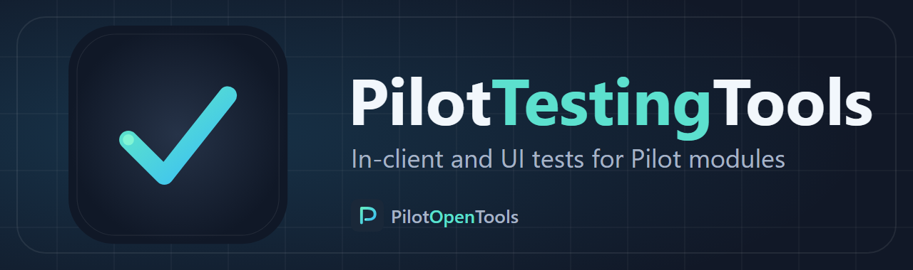

<p align="center"></p>

# PilotTestingTools

[](https://github.com/PilotOpenTools/PilotTestingTools/actions/workflows/ci.yml)

Инструменты автоматического тестирования модулей Pilot-ICE Enterprise и Pilot-BIM. Две части, которые работают вместе или по отдельности.

**PilotTestHost** выполняет тесты внутри процесса клиента Pilot. Тест получает `IObjectsRepository` и другие сервисы Pilot SDK, результат записывается в JSON. Запуск из меню клиента или из консоли.

**PilotUITesting** управляет настоящим клиентом снаружи через UI Automation, как пользователь, и проверяет результат в базе через Server API. Библиотека не ссылается на Pilot SDK и использует только Server API.

Версия 0.4.0, ранняя. Публичный API может измениться до 1.0.

## Зачем

Объекты Pilot SDK (`IObjectsRepository`, `IDataObject`, сервисы вкладок и меню) существуют только в процессе клиента. Вне клиента их не создать, поэтому логика модуля, которая их использует, не проверяется обычным `dotnet test`. Обычный `dotnet test` подходит для логики, не зависящей от Pilot.

- PilotTestHost запускает такие тесты в самом клиенте.
- PilotUITesting проверяет то, что видит пользователь: вкладки, меню, панели команд, карточки и диалоги.

## Что покрывает

- Тесты кода, который работает с Pilot SDK и не запускается вне клиента (`[PilotFact]`).
- Сквозные UI-тесты модуля: открыть вкладку, нажать пункт меню, заполнить карточку, проверить результат в базе.
- Подготовка и уборка тестовых данных через Server API (песочница с окончательным удалением).
- Артефакты падения UI-теста: снимок экрана, дерево окон, окна ошибок Pilot, отказы сервера, журналы модулей.

Не реализовано: параметризованные тесты (`[PilotTheory]`), фикстуры уровня класса в PilotTestHost, отчёт TRX.

## Состав

| Проект | Платформа | Назначение |
|---|---|---|
| `src/PilotTestHost.Sdk` | net48 | атрибут `[PilotFact]`, `ITestContext`, `IPilotTestLogger`. Пакет NuGet |
| `src/PilotTestHost.Plugin` | net48 | плагин-хост `PilotTestHost.ext2`: меню «Run Tests», запуск тестовых сборок, JSON-отчёт, окно-сводка |
| `src/PilotTestHost.Cli` | net8.0 | `pilottest`: запускает клиент с тестами из консоли, код выхода показывает число неуспешных тестов |
| `src/PilotUITesting` | net48 | библиотека UI-тестов: каталог идентификаторов клиента, компоненты, ожидания, песочница, базовый класс NUnit. Пакет NuGet |
| `tests/PilotUITesting.Tests` | net48 | модульные тесты библиотеки и снимок публичного API |
| `tools/PilotUITesting.Inspector` | net48 | консольный инспектор дерева UI Automation клиента |

## Требования

- Windows и установленный Pilot-ICE Enterprise или Pilot-BIM. Пакет Pilot SDK подключён версии 26.15, UI-каталог проверялся на клиенте 26.11.
- .NET SDK для сборки (проверено на 10.0; в CI установлены 8, 9 и 10). Для `pilottest` нужен .NET 8 Runtime.
- Для UI-тестов: сервер Pilot, учётная запись клиента с сохранённым входом и учётная запись Server API.
- Сохранённый вход клиента (и для `pilottest`, и для UI-тестов) записывает `pilottest --login <сервер> <пользователь> <пароль>` при закрытом клиенте.

UI-тесты проверялись вживую на Pilot-ICE Enterprise. Для Pilot-BIM код клиента общий, но живой прогон не выполнялся.

## Установка

Пакеты NuGet: `PilotTestHost.Sdk` (для проекта с тестами внутри клиента) и `PilotUITesting` (для проекта UI-тестов). Публикует workflow выпуска по тегу, порядок описан в [RELEASING.md](RELEASING.md).

Архивы релиза на странице Releases:

| Файл | Содержимое |
|---|---|
| `PilotTestHost-Plugin-<версия>.zip` | плагин-хост. Распаковать в `%LocalAppData%\ASCON\Pilot-ICE Enterprise\Development\PilotTestHost\` или в `...\Pilot-BIM\Development\PilotTestHost\` |
| `PilotTestHost-Cli-<версия>.zip` | консольный запуск `pilottest` |
| `PilotUITesting-Inspector-<версия>.zip` | инспектор дерева UI Automation |
| `SHA256SUMS.txt` | контрольные суммы всех файлов |

Консольный запуск из архива: распакуйте `PilotTestHost-Cli-<версия>.zip` в любую папку (нужен .NET 8 Runtime), `pilottest.exe` лежит в корне. Плагин-хост из `PilotTestHost-Plugin-<версия>.zip` должен быть установлен, тестовые сборки лежат в его подпапке `Tests\`, у клиента сохранён вход (см. «Быстрый старт»).

```powershell
.\pilottest.exe --filter "MyPlugin.Tests.*" --output report.json
```

Без `--client` ищется `C:\Program Files\ASCON\Pilot-ICE Enterprise\Ascon.Pilot.PilotEnterprise.exe`, затем `C:\Program Files\ASCON\Pilot-BIM\Ascon.Pilot.PilotBIM.exe`; другой путь задаётся `--client <exe>`. Список аргументов: `pilottest.exe --help`.

Инспектор: в `PilotUITesting-Inspector-<версия>.zip` лежит `PilotUITesting.Inspector.exe` (.NET Framework 4.8) с зависимостями. Он подключается к запущенному клиенту по имени процесса (команда `start` запускает процесс сама) и сохраняет дерево UI Automation и снимок экрана в `%TEMP%\PilotUITesting`. Команды `dump`, `shot`, `start`, `click`, `row`, `type`, `keys`, `cancel`:

```powershell
.\PilotUITesting.Inspector.exe dump Ascon.Pilot.PilotEnterprise
```

Подробнее: [docs/pilot-ui-testing.md](docs/pilot-ui-testing.md#инспектор).

## Быстрый старт

### Тесты внутри клиента

Тестовый проект ссылается на `PilotTestHost.Sdk` без копирования сборки в выходную папку: сборку SDK деплоит плагин-хост, обе стороны должны использовать один экземпляр.

```xml
<PackageReference Include="PilotTestHost.Sdk" Version="0.4.0" ExcludeAssets="runtime" />
```

```csharp
using PilotTestHost.Sdk;

public class MyPluginTests
{
    [PilotFact]
    public void Repository_Has_Types(ITestContext ctx)
    {
        var types = ctx.Repository.GetTypes().ToList();
        ctx.Logger.Info($"типов в базе: {types.Count}");
        if (types.Count == 0) throw new Exception("в базе нет типов");
    }
}
```

После сборки в Debug пакет сам копирует `MyPlugin.Tests.dll` с зависимостями в подпапку `Tests\` плагина-хоста установленных клиентов. Запуск из консоли:

```powershell
pilottest --filter "MyPlugin.Tests.*" --output report.json
```

Коды возврата: `0` - все тесты прошли, `N` - число упавших и завершившихся ошибкой, `101` - сбой инфраструктуры (клиент не найден, таймаут, нет отчёта), `102` - фатальная ошибка прогона. Подробности: [docs/pilot-test-host.md](docs/pilot-test-host.md).

### UI-тесты снаружи

Рядом с тестовой сборкой лежит `pilot-ui-tests.json`:

```jsonc
{
  "client": "PilotIce",                         // PilotIce | PilotBim
  "serverUrl": "http://host:5545/database",     // сервер и база
  "clientUser": "bot (Инженер)",                // под кем вошёл клиент: подпись кнопки профиля (сверяется)
  "dpiAware": true,
  "resetUiBeforeEachTest": true
}
```

Учётную запись Server API держите вне git, в `pilot-ui-tests.local.json` или в переменных окружения `PILOT_UI_API_LOGIN` и `PILOT_UI_API_PASSWORD`.

```csharp
public class MyModuleTests : PilotUiTestBase
{
    [Test]
    public void Модуль_по_документу_без_данных_пуст()
    {
        ObjectRef document = TestData.CreateDocument(TestData.Unique("Документ"), filePath: PilotTestFiles.Pdf("doc"));

        PilotExplorer explorer = OpenExplorer(TabLifetime.Test);
        explorer.GoTo(document);
        PilotModuleView view = Track(PilotModuleView.OpenedBy(App, "MyModuleView",
            () => explorer.ContextMenu().Click("MyModuleContextMenuItem")));

        Assert.That(view.WaitText(t => t.StartsWith("Всего - ")), Does.StartWith("Всего - 0"));
    }
}
```

Конфигурация, каталог идентификаторов `PilotIds`, особенности клиента и инспектор описаны в [docs/pilot-ui-testing.md](docs/pilot-ui-testing.md).

## Сборка и тесты

```powershell
dotnet build PilotTestingTools.sln -c Release
dotnet test PilotTestingTools.sln -c Release
```

Debug-сборка `PilotTestHost.Plugin` дополнительно копирует файлы в папки `Development\PilotTestHost` клиентов Pilot-BIM и Pilot-ICE Enterprise. Контрактные тесты каталога (`[Explicit]`, категория `PilotContract`) требуют живой клиент и сервер, в CI они пропускаются. Настройки стенда лежат в `tests/PilotUITesting.Tests/pilot-ui-tests.json`, свои значения кладите в `pilot-ui-tests.local.json`.

## Выпуск

Файлы релиза собирает `tools/pack-release.ps1`, по тегу `v*` их собирает и workflow на GitHub Actions: он же создаёт черновик релиза с пометкой pre-release и публикует пакеты в nuget.org. Порядок: [RELEASING.md](RELEASING.md). История изменений: [CHANGELOG.md](CHANGELOG.md).

## Участие

Правила участия: [CONTRIBUTING.md](https://github.com/PilotOpenTools/.github/blob/main/CONTRIBUTING.md). Кодекс поведения: [CODE_OF_CONDUCT.md](https://github.com/PilotOpenTools/.github/blob/main/CODE_OF_CONDUCT.md).

## Лицензия

Проект распространяется по лицензии [Apache 2.0](LICENSE). Версии 0.2.0 и 0.3.0 (пакеты NuGet и исходники по тегам) выпущены под MIT и остаются под ней; Apache-2.0 действует с версии 0.4.0 ([CHANGELOG.md](CHANGELOG.md)).
